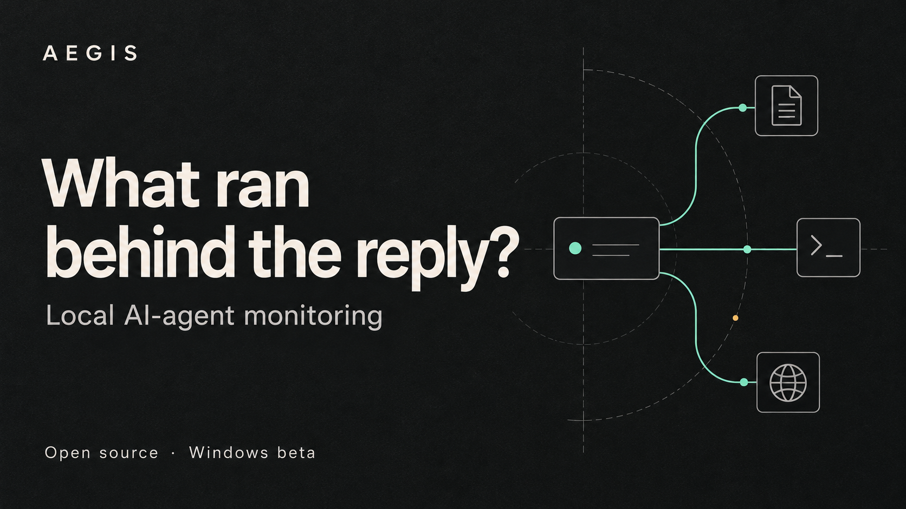

# AEGIS

*Editorial illustration.*

An AI coding session leaves more than an answer: processes, file activity, network connections and resource use. AEGIS brings those observations into a desktop workspace you can inspect.

AEGIS is an open-source application for people who use local AI agents and want to understand the work happening on their machine. The Windows beta is available now under the MIT license.

*Monitoring workspace. Simulated source UI captured on 11 October 2026.*

## Follow the process tree

Start with a detected agent, inspect its processes and follow the related file and network views. CPU and memory charts help you see how the session uses your machine; Claude Code usage views add observed token subtotals and estimated costs.

## Give an alert some context

Open a sensitive-file alert, inspect the captured evidence and its detection reason, and save your review. The investigation views put the observed path, process identity and surrounding activity within reach while you decide what needs attention.

## Review the next workspace

Use Local security to inspect a project, skill or profile configuration. Review static findings, compare saved snapshots and bring an offline report into the same workspace. It is a practical place to begin when adopting a new tool or revisiting a familiar setup.

*Local security workspace. Simulated source UI captured on 11 October 2026. [Screenshot provenance](https://github.com/antropos17/Aegis/blob/master/docs/screenshots/README.md).*

## Keep a useful record

Move from the activity views to alerts, audit history and statistics, then export the evidence you need. JSON, CSV, HTML and ZIP exports help carry an investigation into your own notes or a reproducible report.

For workflows that need a reviewed execution route, AEGIS also offers explicitly configured selected-action policies and MCP gateways. [Explore the capabilities](https://github.com/antropos17/Aegis/blob/master/docs/CAPABILITIES.md) and choose a setup that fits your tools.

[Download the Windows beta](https://github.com/antropos17/Aegis/releases/tag/aegis-v0.20.1-beta) · [Verify the download](https://github.com/antropos17/Aegis/blob/master/docs/RELEASE-VERIFICATION.md)

If this is useful to you, [star AEGIS on GitHub](https://github.com/antropos17/Aegis) to follow the project. Want to help build it? [Contribute an agent signature, detection rule, documentation improvement or reproducible bug report](https://github.com/antropos17/Aegis/blob/master/CONTRIBUTING.md).

*AEGIS 0.20.1-beta · Windows first · MIT licensed. Published by the AEGIS project on 26 October 2026. [Documentation](https://github.com/antropos17/Aegis/blob/master/docs/README.md).*

[Visual overview](https://antropos17.github.io/aegis-media/) · [Standalone article](https://write.as/niwig9zl9o4jn.md)

[Codex community discussion](https://github.com/openai/codex/discussions/57001) · [Open App Scout listing](https://openappscout.com/apps/aegis/) · [MCP Harbor listing](https://mcpharbor.app/tools/antropos17-aegis/)

This is the AEGIS project's public media repository. The application source and issue tracker are at [antropos17/Aegis](https://github.com/antropos17/Aegis). Artwork and copy use the MIT license. Source UI screenshots retain their original provenance captions.

