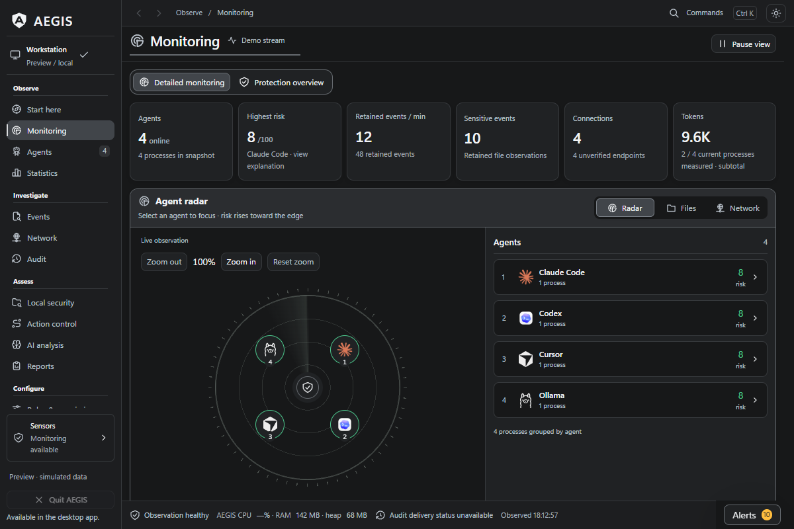
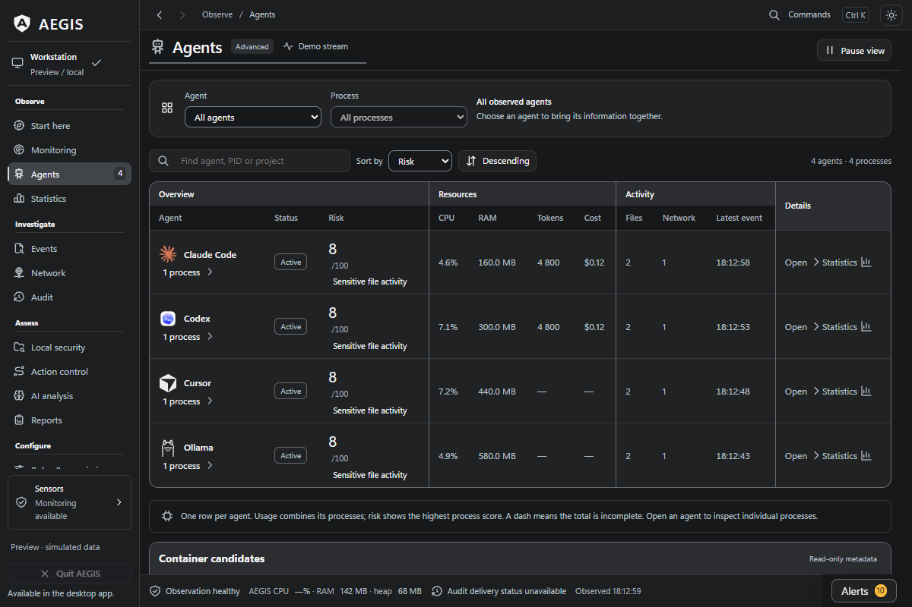

# AEGIS

*Editorial illustration.*

A coding agent can finish a reply while its work spreads across child processes, files and network connections. The chat transcript gives you one view of that activity. AEGIS gives you a desktop workspace for investigating the observations around it.

AEGIS is an MIT-licensed, Windows-first application for monitoring local AI agents. It brings detected processes and process trees, activity in configured file locations, TCP endpoints, resource charts, alerts and audit reports together. It also includes Claude Code usage subtotals and estimates, plus local reviews of project, skill and profile configuration.

A useful first session is small: run your normal agent task, inspect the detected process tree, then look at the file and connection observations you care about. Report a reproducible coverage gap if the view misses something you expected.

Default monitoring observes and records activity. Process actions are explicit. Selected-action policies and MCP gateways need separate setup and cover activity routed through them. Coverage depends on available sensors and process identity; unknown or short-lived processes and some file activity can be missed.

The published Windows build is **0.20.1-beta**. macOS and Linux support remain experimental. Monitoring needs no agent plugin or subscription. Data is stored locally; optional Anthropic analysis sends activity metadata on request using your own API key and provider charges.

[Source and project overview](https://github.com/antropos17/Aegis) · [Windows beta](https://github.com/antropos17/Aegis/releases/tag/aegis-v0.20.1-beta) · [Verify downloads](https://github.com/antropos17/Aegis/blob/master/docs/RELEASE-VERIFICATION.md) · [Capabilities and limits](https://github.com/antropos17/Aegis/blob/master/docs/CAPABILITIES.md)

Useful feedback: which agent did you run, which observation helped, and what did you expect to see? Remove credentials, private paths and project content from public reports.

## Inside the workspace

*Source UI preview with simulated data, captured 11 October 2026.*

*Source UI preview with simulated data, captured 11 October 2026.*

[Capture provenance](https://github.com/antropos17/Aegis/blob/master/docs/screenshots/README.md). These captures show the interface and do not establish complete live capture or automatic blocking.

## Media and reuse

This is the AEGIS project's public campaign and media repository. The application source and issue tracker remain in [antropos17/Aegis](https://github.com/antropos17/Aegis). Release notes describe each installer; newer source work may differ. DNS naming and GitHub update checks use the network. No overall detection-rate or whole-app overhead guarantee has been established.

The campaign artwork and text use the MIT license. Product screenshots are reproduced from the MIT-licensed AEGIS repository, with their original provenance above.

